## 👋 Hi, I'm Ganang Setyo Hadi

**Full-Stack & AI Engineer | Building real systems end-to-end**

---

**Full-Stack Engineer @ Radio Republik Indonesia (RRI)** • **Ex-Full-Stack Intern @ Telkom Indonesia (Digistar)** • **1st Place @ UTU Awards 2025** • **Best Capstone Team @ DBS Foundation 2025**

Banda Aceh, Indonesia | Open to Work Opportunities & Collaboration

---

### Projects

- [**ocr-v3-telkom**](https://github.com/notsuperganang/ocr-v3-telkom) — Full-stack OCR system for automated Telkom contract data extraction
- [**sikupi**](https://github.com/notsuperganang/sikupi) — AI-powered coffee waste marketplace for circular economy in Banda Aceh
- [**PURRPAL**](https://github.com/notsuperganang/PURRPAL) — AI cat health platform addressing veterinary access gaps in Indonesia
- [**lab-gos-management-system**](https://github.com/notsuperganang/lab-gos-management-system) — Full-stack lab management system for equipment lending, reservations, and tracking
- [**dotfiles**](https://github.com/notsuperganang/dotfiles) — My Arch + Hyprland setup with a customized Quickshell desktop

---

### Tech Stack

---

### Connect

---

### Contributions

---

> I use Arch btw.
